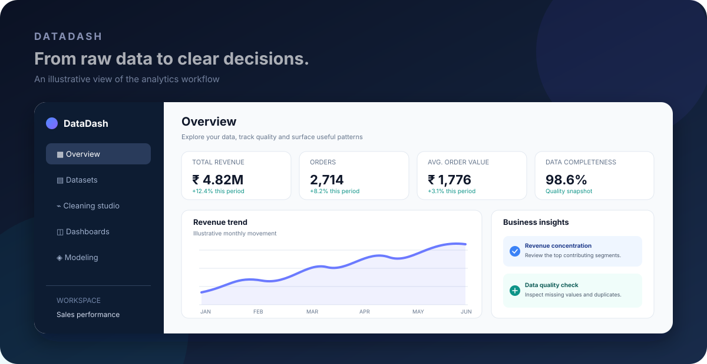
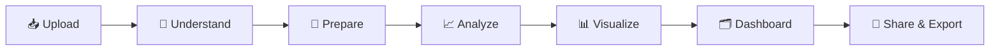

<div align="center">

# 📊 DataDash

### From raw datasets to decision-ready insights.

**A full-stack analytics workspace to profile, prepare, explore, visualize, and share data — without losing sight of how results were produced.**

[](VERSION)
[](https://github.com/SaiKiran0078/Datadash/actions/workflows/ci.yml)
[](https://github.com/SaiKiran0078/Datadash)
[](frontend/)
[](backend/)
[](backend/)
[](LICENSE)

**🚀 Live Demo:** Pending Render deployment and health-check verification · [Render setup](docs/RENDER_DEPLOYMENT.md)  
**📚 Documentation:** [Guides](docs/) · [API Reference](docs/API.md) · [Architecture](docs/ARCHITECTURE.md) · [Deployment](docs/DEPLOYMENT.md) · [Render deployment](docs/RENDER_DEPLOYMENT.md)

</div>

<p align="center">
  
</p>

---


## 🖥️ Product preview

> The SVG above is an original **illustrative graphic**, not a screenshot. Real application screenshots will be captured and added after the new deployment is live and smoke-tested.

## ✨ What is DataDash?

DataDash is a browser-based data analytics application built around the workflow analysts use every day:



Bring in CSV, TSV, or Excel data, inspect its structure and quality, apply deliberate cleaning steps, explore descriptive statistics, build interactive charts and dashboards, and export your work for reporting.

## 🌟 Key capabilities

| Workspace | What it helps you do |
|---|---|
| 📥 **Data import** | Load CSV, TSV, and XLSX files; select workbook sheets and inspect dataset dimensions |
| 🔎 **Data profiling** | Review inferred column types, missing values, duplicates, distributions, and quality signals |
| 🧹 **Data preparation** | Preview and apply cleaning operations, transform columns, calculate fields, and use undo/redo snapshots |
| 🧠 **Exploratory analysis** | Explore descriptive summaries, category breakdowns, quartiles, skew, correlations, and outliers |
| 📊 **Visualization** | Create bar, line, pie, histogram, and scatter charts with chart recommendations |
| 🗂️ **Dashboards** | Save multi-widget dashboards, apply filters, and create read-only share links |
| 🧮 **Modeling workbench** | Build pivot tables and calculated columns with a restricted formula engine |
| 📤 **Reporting & export** | Generate narrative reports and export to Excel, PowerPoint, Power BI project, and Tableau packaged workbook formats |
| 🔐 **Access controls** | Authenticate users, scope resources by owner, apply rate limits, and share dashboards read-only |

> **Analytical integrity:** DataDash's built-in Insight Assistant uses deterministic, dataset-based rules. It is not presented as a connected generative-AI model. Correlation is not causation, and unusual values are investigation signals—not automatic proof of bad data.

## 🧭 Typical analyst workflow

1. **Upload** a CSV, TSV, or Excel workbook.
2. **Understand** the dataset through profiles, detected types, and quality diagnostics.
3. **Prepare** the data using previewable, explicit cleaning operations.
4. **Analyze** distributions, segments, relationships, and outliers.
5. **Visualize** important measures using configurable charts.
6. **Build** a dashboard from saved visualizations and filters.
7. **Deliver** reports, portable exports, or a read-only dashboard link.

## 🧱 Technology stack

| Layer | Technologies |
|---|---|
| Frontend | React 18 · Vite · React Router · Chart.js |
| Backend API | Python · FastAPI · Uvicorn · Pydantic |
| Data processing | pandas · NumPy · openpyxl |
| Persistence | SQLAlchemy · PostgreSQL (Docker deployment) · SQLite (local development) |
| Exports | openpyxl · python-pptx · Power BI and Tableau project packages |
| Serving & deployment | Docker · Docker Compose · Nginx · optional Caddy HTTPS proxy |
| Quality | pytest · Node test runner · Ruff · GitHub Actions |

## ⚡ Run locally with Docker

### Prerequisites

- [Docker Desktop](https://www.docker.com/products/docker-desktop/) or Docker Engine with the Compose plugin
- Git
- A modern browser

### 1. Clone the repository

```bash
git clone https://github.com/SaiKiran0078/Datadash.git
cd Datadash
```

### 2. Configure secrets

```bash
cp .env.example .env
```

Generate strong, independent values for `POSTGRES_PASSWORD` and `SECRET_KEY` and place them in `.env`. Never commit `.env` or share production secrets.

Example non-secret settings:

```dotenv
CORS_ORIGINS=http://localhost:8081
DATADASH_PORT=8081
```

### 3. Start DataDash

```bash
docker compose up --build -d
docker compose ps
```

Open **http://localhost:8081**.

### Handy Docker commands

```bash
# Follow application logs
docker compose logs -f backend frontend

# Rebuild app services after code changes
docker compose up -d --build backend frontend

# Stop containers but preserve persistent data
docker compose down
```

⚠️ Avoid `docker compose down -v` during normal maintenance. The `-v` option removes named volumes and can permanently delete database and uploaded-dataset data.

## 🛠️ Local development without Docker

Python 3.12+ and Node.js 20+ are recommended.

**Backend (PowerShell):**

```powershell
cd backend
py -3.12 -m venv .venv
.\.venv\Scripts\Activate.ps1
python -m pip install -r requirements-dev.txt
Copy-Item .env.example .env
uvicorn app.main:app --reload --port 8000
```

API: `http://localhost:8000` · Interactive API docs: `http://localhost:8000/api/docs`

**Frontend (second terminal):**

```powershell
cd frontend
npm ci
npm run dev
```

Use the Vite URL printed in the terminal. Configure the API origin with `VITE_API_URL` when the frontend and backend run on separate origins.

## ✅ Run quality checks

**Backend (from `backend/`):**

```bash
python -m compileall -q app tests
ruff check app tests
pytest -q
```

**Frontend (from `frontend/`):**

```bash
npm test
npm run build
```

GitHub Actions CI configuration is maintained in [`.github/workflows/`](.github/workflows/).

## 🗃️ Repository structure

```text
DataDash/
├── .github/
│   └── workflows/          # CI automation
├── backend/
│   ├── app/
│   │   ├── api/routes/     # Auth, datasets, dashboards, reports
│   │   ├── core/            # Settings, security, rate limiting
│   │   ├── db/              # SQLAlchemy models and sessions
│   │   ├── engine/          # Profiling, cleaning, analysis, insights
│   │   └── services/        # Dataset and dashboard services
│   └── tests/               # Backend tests
├── deploy/                  # Reverse-proxy examples
├── docs/                    # Workflow, API, architecture, deployment guides
├── frontend/
│   ├── public/              # Static assets
│   └── src/                 # React application and components
├── sample_data/             # Demonstration datasets
├── docker-compose.yml
├── .env.example
├── CONTRIBUTING.md
├── LICENSE
├── README.md
└── VERSION
```

## 📖 Documentation

- [Analyst workflow](docs/ANALYST_WORKFLOW.md)
- [API reference](docs/API.md)
- [System architecture](docs/ARCHITECTURE.md)
- [Deployment guide](docs/DEPLOYMENT.md)
- [Render Blueprint deployment](docs/RENDER_DEPLOYMENT.md)
- [Modeling workbench](docs/MODELING_WORKBENCH.md)
- [Portable exports](docs/PORTABLE_EXPORTS.md)
- [Contributing guidelines](CONTRIBUTING.md)
- [Security policy](SECURITY.md)

## 🔒 Data handling & security notes

- Uploads are restricted by supported file types and configured size, row, and column limits.
- Workbook sheets are handled as selectable sources; unrelated sheets are not silently combined.
- Cleaning operations are previewed before explicit application.
- Keep original source files when you need an independent rollback path.
- Before public deployment, replace example secrets, configure exact CORS origins, enforce HTTPS, and review backups and monitoring.
- Back up the PostgreSQL database and uploaded dataset volume together; metadata alone is not a complete backup.

Read [SECURITY.md](SECURITY.md) before deploying a public instance.

## 🤝 Contributing

Issues and pull requests are welcome. Please read [CONTRIBUTING.md](CONTRIBUTING.md), include reproduction steps for bugs, and add or update tests when behavior changes.

## 📄 License

See the [LICENSE](LICENSE) file for the terms that apply to this project.

---

<div align="center">

**Built to make data work clearer, more traceable, and easier to share.**

⭐ If DataDash is useful to you, consider starring the repository.

</div>
