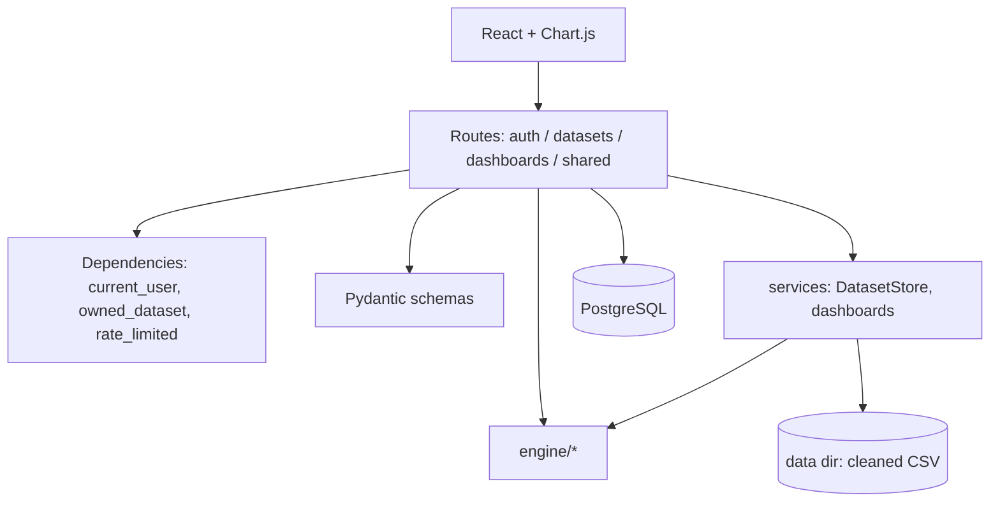
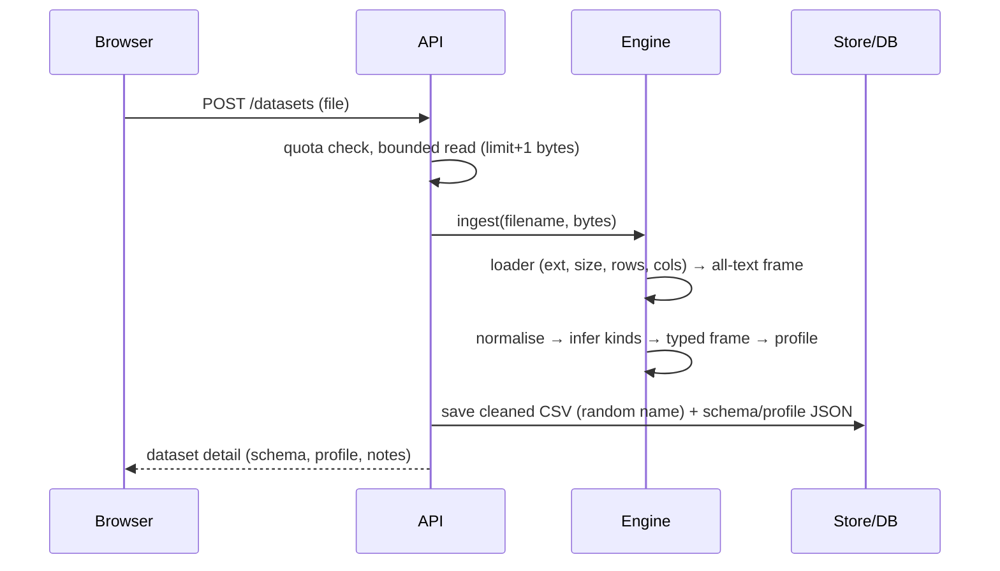

# DataDash Architecture

## Overview
React SPA → FastAPI → pandas engine, with PostgreSQL for accounts/metadata/dashboards and a folder of cleaned CSV files for the data itself. nginx serves the SPA and proxies `/api`.

## Layers
| Layer | Folder | Rule |
|---|---|---|
| Routes | `app/api/routes` | HTTP only: validate, authorise, call a service/engine function, shape the response |
| Engine | `app/engine` | **Pure pandas, no web framework.** Everything interesting lives here and is unit-tested directly |
| Services | `app/services` | Glue: file store with cache, dashboard rendering |
| Core / DB | `app/core`, `app/db` | Settings, security primitives, models |

### The engine (`app/engine`)
| Module | Job |
|---|---|
| `loader.py` | Validate and parse upload bytes into an all-text frame (CSV/TSV/XLSX) |
| `inference.py` | Clean names, normalise missing tokens, **detect column kinds**, cast |
| `profile.py` | Summary statistics per column |
| `outliers.py` | IQR bounds, counts, most extreme rows |
| `recommend.py` | Rule-based chart suggestions with scores and reasons |
| `query.py` | Allow-listed filters, aggregation, chart-data builders, table paging |
| `pipeline.py` | `ingest()`: loader → normalise → infer → profile |
| `serialize.py` | NaN/Timestamp/numpy → JSON-safe values |

## Data flow: upload

## Key design decisions
1. **Read everything as text first.** CSV and Excel then follow the *same* inference path, so "₹1,200" and a native Excel number behave identically and detection lives in one file.
2. **Detection by parse-success ratio.** A column is numeric if ≥ 95 % of its non-empty values parse as numbers (handling currency symbols, thousands separators, `%`, accounting negatives `(50)`), date if ≥ 95 % parse as dates. Leading-zero strings (`00123`) and all-digit strings are *not* treated as numbers/dates. Tolerance for a few dirty cells is what makes real-world files work.
3. **Schema stored, not re-detected.** Detection runs once at upload; the schema JSON is saved in the DB and re-applied when the CSV is reloaded, so types never change between requests.
4. **Allow-listed query engine.** Requests contain *names* (column, operator, aggregation, chart type) and *values*, never expressions. Each name is validated against the schema/allow-list; values are coerced to the column type. This removes the injection risk that comes with building queries from strings.
5. **Rule-based recommendations.** Date + number → line; category + number → bar (pie when ≤ 6 groups); number → histogram (boosted when outliers exist); correlated numbers → scatter. Column *names* tune the choice: revenue/sales/amount lead and are summed, units/quantity are summed, price/rate/rating are averaged. Each suggestion has a score, a reason, and per-type caps so the list stays varied.
6. **Deterministic output.** Scatter sampling uses evenly spaced indices, not random, so the same request returns the same picture.
7. **Widgets fail independently.** `render_widgets` catches errors per widget, so one stale chart (e.g. a column that no longer exists) shows an error card instead of breaking the dashboard.
8. **Public sharing is read-only and minimal.** The share endpoint returns computed chart data only. It never returns the schema, rows, owner, or dataset id.
9. **App factory.** `create_app(settings)` lets tests build an isolated app (in-memory DB, temp folder, rate limiting off).

## Scaling ideas
- Parquet/DuckDB instead of CSV for fast column reads and larger files.
- Redis for rate limiting and caching rendered dashboards.
- Background jobs for very large uploads; object storage (S3) for dataset files.
- Alembic migrations; row-level caching keyed by (dataset, spec, filters).
